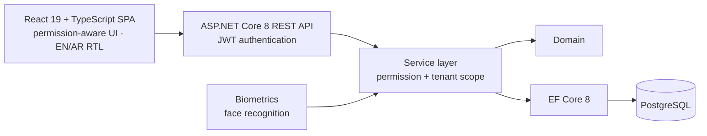

  

<h1 align="center">Hi, I'm Youssef Emad 👋</h1>

  <strong>Full Stack .NET Developer · C# / ASP.NET Core / React</strong> 
  Cairo, Egypt

  
  
  

Full Stack .NET Developer specializing in C# and ASP.NET Core with React and TypeScript. I took a multi-tenant HR platform from requirements to delivery for a commercial client, and I care about Clean Architecture, SOLID principles, RESTful API design, authentication and authorization, and relational database design with SQL Server and PostgreSQL.

## Experience

### Freelance Full Stack .NET Developer — Revive HR

**Sep 2026 – Nov 2026** · Multi-tenant HR platform for gym businesses

Owned the engagement end to end — requirements, architecture, implementation, testing, and delivery — for a commercial client.

- **Authorization** — designed a dynamic model in which each tenant defines its own roles, permissions, and access rules around its organizational structure.
- **Delivery** — shipped REST APIs and a permission-aware React/TypeScript frontend for employee management, attendance, and HR operations, plus a face-recognition module linking an existing face-ID model to per-branch check-in.
- **Quality** — backed it with a 700+ test xUnit suite (integration and security) running the API against a real PostgreSQL database, covering payroll, attendance, requests, tenant isolation, and JWT/CORS security.

## Selected work — Revive HR

The hard part was never HR CRUD — it was making tenancy an architectural boundary instead of a filter bolted onto queries: each tenant owns its roles, permissions, and access rules, and every request is authorized against them below the API surface.

Delivered with 40 EF Core migrations, 700+ xUnit tests across integration and security suites running against a real PostgreSQL database, and Playwright end-to-end suites covering both API and UI flows.

## Technical skills

| Area | Stack |
| --- | --- |
| **Backend** | C# · ASP.NET Core 8 · EF Core · REST APIs · SignalR · xUnit |
| **Frontend** | React · TypeScript · Next.js · Angular · Tailwind CSS |
| **Architecture** | Clean Architecture · SOLID · Repository · Unit of Work · Specification |
| **Data & security** | PostgreSQL · SQL Server · Redis · JWT · ASP.NET Identity · OAuth 2.0 · RBAC |
| **DevOps & tools** | Docker · Kubernetes · AWS · Terraform · Jenkins · CI/CD · Git |

Also comfortable with: LINQ · Swagger/OpenAPI · Postman · HTML/CSS · GitHub

## Technical projects

### PulseGym — Smart Fitness Management Platform

**Dec 2025 – Jun 2026** · Graduation project · [Live demo](https://pulsegym-two.vercel.app)

Led backend development in a 5-member team, delivering a RESTful API with 150+ endpoints covering users, memberships, workouts, bookings, subscriptions, and payments.

- Designed the backend with Clean Architecture and a 56-table PostgreSQL database, applying relational design, indexing, and query optimization techniques.
- Implemented authentication and authorization using JWT, ASP.NET Identity, OAuth 2.0, and RBAC across Member, Coach, Reception, and Admin roles.
- Integrated Redis caching, SignalR real-time communication, and Stripe payments with secure webhook handling, plus AI-powered workout and nutrition generation.

### E-Commerce Platform

[Code](https://github.com/youssefemaad/E-Commerce.Api) · ASP.NET Core 8 · EF Core · SQL Server · Redis · JWT · ASP.NET Identity · Stripe · Angular

Built a full-stack e-commerce platform with ASP.NET Core 8 and Clean Architecture — product catalog, cart, orders, authentication, and payments — applying Repository, Unit of Work, and Specification patterns.

- Implemented JWT authentication, ASP.NET Identity, role-based authorization, token refresh, and Redis response caching.
- Built an Angular frontend integrated with the backend APIs and Stripe checkout.

### DevOpsPilot — URL Shortener

[Code](https://github.com/youssefemaad/DevOpsPilot) · AWS EKS · Kubernetes · Terraform · Jenkins · Docker · Redis · SQLite

Built a containerized URL shortener with persistent mappings, redirects, and Redis caching; provisioned AWS infrastructure with Terraform (Amazon EKS cluster) and automated deployment with Jenkins, Docker, and Kubernetes.

## Education

**El Shorouk Academy** — Bachelor of Computer Science · Sep 2022 – Jun 2026 · Grade: Very Good

## Certifications

- .NET Backend Development — Route Academy (2025)
- DevOps Engineering — DEPI (2025)

## Languages

Arabic (native) · English (B2 — professional working proficiency)

## Let's connect

- 💼 [LinkedIn](https://www.linkedin.com/in/youssef-eemad)
- 🐙 [GitHub](https://github.com/youssefemaad)
- 📄 [View my CV (PDF)](https://github.com/youssefemaad/youssefemaad/blob/main/assets/CV-Youssef-Emad.pdf)
- 📧 [eyoussef228@gmail.com](mailto:eyoussef228@gmail.com)

**Open to full stack .NET opportunities · Cairo, Egypt**
